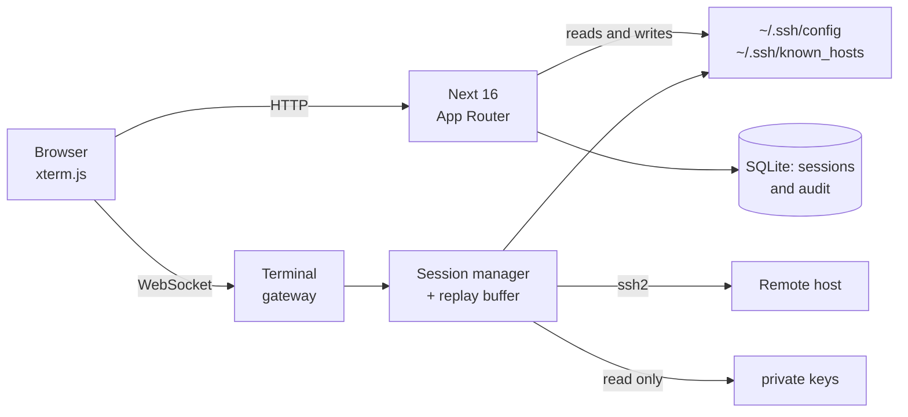

<div align="center">

# ssh-web

**Your SSH terminals in the browser. And they are still there when you close the tab.**

`TypeScript` · `Next 16` · `xterm.js` · `SQLite` · `Docker` or `Windows` · No compiled dependencies

</div>

---

A container that gives you SSH access from the browser to your machines, local
or published, with sessions that **do not die when you close the browser** and
without storing a single secret: your hosts live in `~/.ssh/config`, the same
file you already use.

Leave an `apt upgrade` running, shut the laptop, open your phone and carry on
watching the same session. That is the problem it solves.

## Why

Web SSH tools usually tie the connection to the tab: close it and you lose the
process. Here the SSH connection lives in the server process. The tab is just a
window you look through, and you can look through several at once.



## What it does

- **A real terminal** in the browser: colours, `vim`, `htop`, `tmux`, automatic
  resizing.
- **Resumable sessions.** Close the browser, lose the wifi, come back later and
  resume with the recent output repainted.
- **Several viewers** on the same session, live.
- **Your hosts in `~/.ssh/config`.** The standard OpenSSH file, which the
  application reads and writes. It still works with your everyday `ssh`
  client, and backing it up means copying one text file.
- **No secrets stored by default.** Passwords are asked for on connect and only
  live in memory. Private keys are read from a read-only mounted directory and
  never copied anywhere.
- **Optional encrypted vault** if you would rather not retype passwords,
  locked with your sign-in password.
- **Standard `~/.ssh/known_hosts`.** Trust on first use, and if a server key
  changes the connection is cut.
- **You choose where everything lives** from the settings screen.
- **Runs in Docker or natively on Windows**, from the same code.
- **Installable as an app** on desktop and mobile, full screen. Requires HTTPS
  or `localhost`, which is what browsers demand.
- **History and audit trail** of sign-ins, hosts and sessions.

## Why the OpenSSH files

Because restoring an installation should not depend on this application. If you
stop using it tomorrow, your `~/.ssh/config` is still valid for `ssh`, `scp`,
`rsync` and anything else. And if the database is lost, you only lose the
history: not one host, not one key.

## Getting started

### Windows, without Docker

Install [Node.js 24](https://nodejs.org) and double-click **`start.cmd`**. The
first run installs and builds; after that it starts in seconds and opens the
browser for you. Details in
[docs/WINDOWS-INSTALL.md](docs/WINDOWS-INSTALL.md).

If you already used `ssh` on Windows your hosts show up with no configuration
at all: OpenSSH keeps its configuration in `%USERPROFILE%\.ssh\config`, which
is exactly the file ssh-web reads.

### Docker

```bash
# 1. Point it at your SSH files (optional: defaults to ./ssh)
cat > .env <<'EOF'
SSH_WEB_SSH_DIR_HOST=/home/your-user/.ssh
SSH_WEB_KEYS_DIR_HOST=/home/your-user/.ssh
EOF

# 2. Start it
docker compose up -d --build

# 3. Open the application and create the first user.
#    Sign-up closes as soon as an account exists.
```

If you already had a `~/.ssh/config`, your hosts appear in the dashboard with
nothing else to do.

It listens on `127.0.0.1:3030` by default. To reach it from another machine
without exposing anything to the network, use a tunnel:

```bash
ssh -L 3030:127.0.0.1:3030 user@server   # then http://localhost:3030
```

If you would rather have direct access from your local network, put your
server address in a `.env` file:

```bash
SSH_WEB_BIND=192.168.1.10
```

Bear in mind that without TLS the traffic travels in the clear across that
network: the sign-in password, the session cookie and everything you type into
the terminal.

> ⚠️ Pointing the mounts at your whole `~/.ssh` is the most convenient option,
> and it exposes every private key you own to any flaw in the application. A
> separate keys folder holding only the keys you use here reduces that risk.

## Security

| | |
| --- | --- |
| Passwords | Not stored unless you enable the vault; then encrypted with AES-256-GCM |
| Vault key | Derived from your password with scrypt and its own salt; memory only, never on disk |
| Private keys | Never copied: read from a read-only directory |
| Sign-in password | scrypt N=2¹⁶ with a random salt |
| Web session | Only the SHA-256 fingerprint of the token touches the disk |
| Cookies | `HttpOnly`, `SameSite=Strict`, `Secure` under HTTPS |
| CSRF | Double submit plus an origin check |
| WebSocket | Same origin required |
| Remote host | Standard `known_hosts`; a key change aborts the connection |
| Configurable paths | Confined to allowed folders, checked segment by segment |
| Container | No root, read-only rootfs, `cap_drop: ALL`, `no-new-privileges` |
| Brute force | 5 attempts per user every 15 minutes |

Full detail and the trade-offs taken in
[docs/ARCHITECTURE.md](docs/ARCHITECTURE.md).

## Documentation

- **[User guide](docs/USER-GUIDE.md)** — day-to-day use: adding hosts,
  connecting, resuming sessions, storing passwords, what to do when a server
  key changes.
- **[Windows installation](docs/WINDOWS-INSTALL.md)** — requirements, startup,
  where everything is stored and what differs from Linux.
- **[Architecture and security](docs/ARCHITECTURE.md)** — internal design,
  threat model, configuration and development.

## Status

It works and is tested end to end against real SSH servers: **295 tests**.

Known limitations, in case they matter before you adopt it:

- **Single user.** Sign-up closes after the first account; there is no user
  management.
- **No password change.** Since the vault is encrypted with it, changing the
  password would require re-encrypting the vault, and that is not implemented.
- The vault key lives in memory: after a server restart you have to **sign in
  again** for stored passwords to become available.
- Editing hosts and reading the audit trail exist in the API but have **no
  interface** yet.
- Of `ssh_config` the common subset is interpreted (`Host`, `HostName`, `User`,
  `Port`, `IdentityFile`, wildcards). `Include`, `Match` and `ProxyJump` are
  preserved in the file but **not applied**.
- Sessions **do not survive a server restart**: they live in process memory.
- No TLS of its own. If you publish it, put a reverse proxy in front and set
  `SSH_WEB_SECURE_COOKIES=true`.

## Licence

**Free software.** You may use, copy, modify and distribute it, for anything
you like including commercial use, without asking and without paying. The only
thing asked is that the licence notice is kept in copies.

It is provided **as is and without any warranty**: whoever uses it takes the
risk. This is a tool that handles SSH access to your machines; review it before
trusting anything important to it.

Full terms in [LICENSE](LICENSE) ([MIT](https://opensource.org/licenses/MIT)).

## Stack

Next 16 (App Router) · React 19 · TypeScript · xterm.js · ssh2 · `node:sqlite`
with WAL · Zod · Tailwind 4 · vitest · Node 24 running TypeScript uncompiled.

No compiled dependencies: the container needs no toolchain and runs with a
read-only root filesystem.
